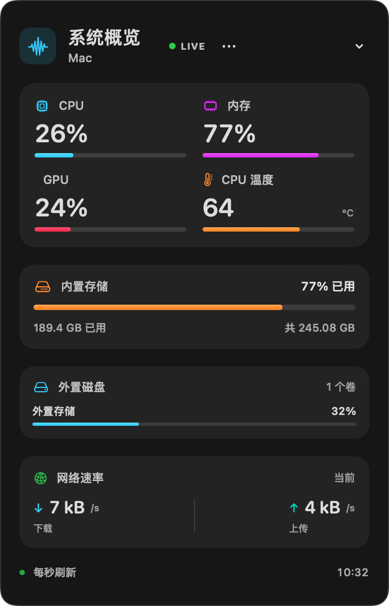
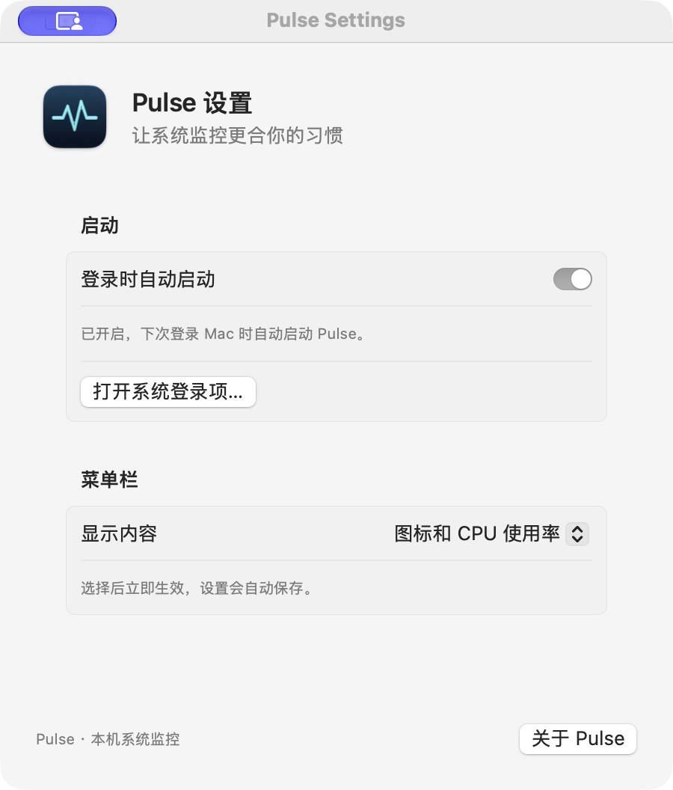

<p align="center">
  
</p>

<h1 align="center">Pulse</h1>
<p align="center">一个简洁的原生 macOS 菜单栏资源监控工具。</p>

Pulse 用 SwiftUI + AppKit 编写。点击菜单栏图标，查看 CPU、内存、GPU、温度、内置存储、外置磁盘与网络速率。无需账户或 API Key，监控数据只在本机读取和显示。

[下载安装包](https://github.com/einsy1/pulse/releases/latest) · [反馈问题](https://github.com/einsy1/pulse/issues)

## 界面



主面板截图使用实际界面与本机读数；设备和外置卷名称已替换为通用名称。读数随设备和运行状态变化。



## 功能

- CPU、内存使用率与磁盘容量。
- GPU 使用率和 CPU 温度：系统能提供读数时显示，否则标记不可用。
- 已挂载外置磁盘的容量使用情况，面板最多展示三个卷。
- 网络下载／上传速率，指标约每秒刷新。
- 菜单栏显示 CPU、内存使用率，或仅显示图标。
- 登录时自动启动开关，以及 macOS 登录项授权状态提示。
- 设置自动保存；右键快捷菜单提供设置、登录启动、关于和退出。

## 安装使用

1. 在 [Releases](https://github.com/einsy1/pulse/releases/latest) 下载 Universal ZIP 并解压。
2. 将 `Pulse.app` 拖到“应用程序”文件夹，再启动。
3. 左键菜单栏图标打开监控面板；右键打开快捷菜单。面板右上角的“更多选项”也能进入设置。
4. 如需自动启动，在设置中打开“登录时自动启动”。若显示等待授权，点击“打开系统登录项…”前往系统设置允许 Pulse。

自动启动不会在首次运行时主动开启，指登录用户账户后启动。截图中开关状态仅代表截图时的本机设置。

**发布包采用 ad hoc 签名，尚未进行 Apple Developer ID 签名和 Apple 公证。** 首次下载运行可能遇到 macOS 安全提示；当前包不具备正式公证应用的即开体验。请确认下载来源；也可以审阅源码后自行构建。应用暂无自动更新功能。

## 系统要求与限制

- macOS 14 或更新版本。
- 发布包为 Universal 2，包含 Apple Silicon 和 Intel 架构。
- 已完成两个架构的编译与签名检查，以及本机 Apple Silicon 界面和设置保存验证；尚未在 Intel 实机及所有 macOS 版本上测试。
- GPU／温度数据受机型和系统版本影响。CPU 温度使用未公开的 HID 传感器接口，系统升级可能使其失效。
- 登录项状态会回读 macOS；未进行注销后重新登录的完整自动启动实测。
- 网络速率按除回环接口外的网络接口累计，使用 VPN／虚拟网卡时可能重复统计；不能作为计费流量依据。
- Pulse 不提供清理、风扇控制、进程管理或安全扫描。

## 从源码构建

需要匹配的 Xcode 或 Command Line Tools 与 macOS SDK。先完成相应工具的安装、首次启动及所需许可步骤。

```sh
git clone https://github.com/einsy1/pulse.git
cd pulse
./build.sh
open Pulse.app
```

脚本分别编译 arm64 与 x86_64，合并为 Universal 2，复制图标资源并进行本机 ad hoc 签名。可以通过 `DEVELOPER_DIR` 指定开发工具目录。

## 项目结构

- `Sources/Pulse/`：应用、指标采集与设置。
- `Resources/`：应用图标与预览。
- `Scripts/GenerateIcon.m`：AppKit 矢量图标绘制源码。
- `Info.plist`：应用信息。
- `build.sh`：Universal 2 构建脚本。
- `docs/images/`：界面截图。
- `PRD.md`：产品需求说明。

## 隐私

不需要账户或 API Key，不上传监控数据，不连接遥测服务。显示偏好保存在本机 UserDefaults；登录启动由 macOS ServiceManagement 管理。

## 许可证

[MIT License](LICENSE)。
